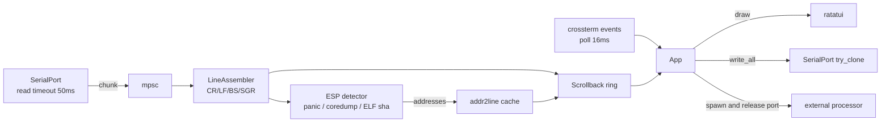

# GTUI — Rust TUI 串口调试终端：需求分析与实施计划

> 状态：已实现并持续补齐，软件验证见 §10，硬件与跨平台验收仍待执行。名称 **GTUI**，许可证 **MIT**，目标平台 **Windows 10+ / Linux**。
> 参考实现：`espressif/esp-idf-monitor`（Python，Apache-2.0）、`hucker/termapy`（Python/Textual，MIT）。本文与后续代码均为独立实现，不复制源文件。

## 1. 结论

做一个**单二进制、零运行时依赖、Windows/Linux 双平台**的 TUI 串口终端：

- 一等公民是 ESP32 日常调试闭环：连接即复位、启动日志、bootloader 模式、panic 地址反解、ELF 校验、coredump 现场保留。
- 同时覆盖通用串口工具的常用能力：端口/波特率/8N1/流控、文本与 HEX 收发、行尾控制、定时发送、时间戳、日志落盘、搜索过滤、收发计数。
- 不做完整 VT100 仿真、不做内置烧录协议、不做插件/MCP。它们用“外部命令钩子”替代（见 ADR-7）。

一句话取舍：**ESP32 特性做深（panic 反解 + 复位时序），通用功能做全但做浅，扩展性靠外部进程而不是插件沙箱。**

## 2. 参考项目拆解

### 2.1 可直接复用的语义（有源码依据）

| 能力 | esp-idf-monitor 的实现事实 | 我们的做法 |
|---|---|---|
| panic 判定 | 状态机：`PANIC_START = r'Core \s*\d+ register dump:'` 进入，`PANIC_END = b'ELF file SHA256:'` 结束，`PANIC_STACK_DUMP = b'Stack memory:'` 进入栈区 | 同样的三段式状态机，常量对齐 |
| 地址反解 | 外部 toolchain `*-esp-*-addr2line`，按行内 `0xADDR:0xSTACK` 提取代码地址 | 进程内 `addr2line` crate；失败/不支持时回落外部命令 |
| ELF 校验 | 解析日志中的 `ELF file SHA256:` 与本地 ELF 比对，不匹配告警 | 同，用 `sha2` |
| 经典复位 | DTR=IO0、RTS=EN；esp32 rev<3 `enter_boot_set=1.3s`、`enter_boot_unset=0.45s`，其余芯片默认 `0.1s/0.05s` | 移植同一时序表，另加 `--chip` 覆盖 |
| USB-JTAG 复位 | 适配器 PID `0x1001` 走另一套脉冲序列 | 按 `available_ports()` 的 VID/PID 选择序列 |
| Windows 复位坑 | `set_rts` 后必须重写当前 DTR，否则 `usbser.sys` 不下发 `SET_CONTROL_LINE_STATE` | 移植该 workaround |
| coredump | 串口 base64 块，标记 `================= CORE DUMP START/END =================` | v0.1 只捕获落盘，不解析 |
| 日志着色 | 行首 `I/W/E` 级别自动着色，跨行颜色用 `_trailing_color` 补 reset | 同 |
| 时间戳/日志/输出开关 | `I` 时间戳、`L` 日志、`Y` 输出 | 改为 TUI 热键 + 状态栏指示 |

### 2.2 termapy 值得抄的产品决策

| 决策 | 依据 | 采用 |
|---|---|---|
| 行式输入（Enter 才发包） | 设备端只需要行缓冲，重放/粘贴/自动化统一 | 默认模式 |
| `/command` 内置命令 | 学习成本低，和普通输入共用一条输入框 | 采用（`//` 转义字面量） |
| 每设备一个配置目录 | 日志/脚本/配置可随项目进 git | 采用（profile） |
| 自动重连 | USB 重新枚举后无需手动重开 | 采用 |
| `--demo` 模拟设备 | 无硬件也能演示与 CI | 采用 |
| 会话日志 + 搜索 + HEX 视图 | 通用工具刚需 | 采用 |
| `.run` 脚本 / 插件 / MCP / 截图 | 属于“工作台”能力 | 延后或不做 |

## 3. 需求

### 3.1 功能需求

| ID | 需求 | 优先级 | 验收要点 |
|---|---|---|---|
| FR-01 | 端口枚举（名称、VID/PID、描述、序列号）与选择器 | P0 | 无参数启动进入选择器；`--list` 文本输出 |
| FR-02 | 连接参数：波特率（预设+自定义）、数据位、校验、停止位、流控 | P0 | 921600 可用；非法组合报错而非静默 |
| FR-03 | 连接时自动硬复位；`--no-reset` 关闭 | P0 | 上电日志从第一行开始 |
| FR-04 | 断线检测与自动重连（可关） | P0 | 拔插 USB 后恢复；重连不重复刷屏 |
| FR-05 | 输出面板：滚动、翻页、自动跟随（用户上翻即暂停，End 恢复） | P0 | 30 万行不卡顿 |
| FR-06 | ANSI SGR（16/256/RGB、bold/underline）渲染；其余 CSI 丢弃 | P0 | `idf.py` 启动日志颜色正确 |
| FR-07 | `\r` 覆写当前行（进度条/覆盖式输出） | P0 | `\r10%\r20%` 只显示一行 |
| FR-08 | 非 UTF-8 字节不丢：行内转义显示 + 计数告警 | P0 | 错误波特率下仍能看到数据 |
| FR-09 | 行式输入 + 历史（↑↓，持久化）+ 光标编辑 | P0 | 历史跨会话保留 |
| FR-10 | 行尾控制 CR/LF/CRLF/None；发送回显可关 | P0 | 四种模式逐字节验证 |
| FR-11 | RAW 透传模式（F2 切换，Ctrl+] 退出） | P0 | 可发 Ctrl+C 打断固件、可应答 `press any key` |
| FR-12 | 时间戳开关（毫秒） | P0 | 与原始日志同时可选 |
| FR-13 | 日志落盘：原始字节 + 可选时间戳；退出/断开时 flush | P0 | kill 后文件可读、无截断行 |
| FR-14 | 收发字节计数与瞬时速率 | P0 | 状态栏可见 |
| FR-15 | ESP 复位菜单：硬复位、进入 bootloader、自定义 `D/R/U/W` 序列 | P0 | 三块不同 USB 转串口板通过 |
| FR-16 | panic 捕获 + 地址反解（Xtensa `Backtrace:` 与 RISC-V `MEPC/Stack memory:`） | P0 | 真实 `abort()` 输出可定位到 file:line |
| FR-17 | ELF 自动发现（`build/*.elf`、`--elf`、profile 配置）+ SHA256 校验 | P0 | 错配 ELF 时醒目告警 |
| FR-18 | 搜索/高亮（子串或正则）+ 级别过滤（I/W/E） | P1 | 大缓冲下查询 <100ms |
| FR-19 | HEX 收视图 + HEX 发送（`/hex 01 0d`） | P1 | 与文本视图可切换，字节不重排 |
| FR-20 | 定时/重复发送（间隔、次数） | P1 | 停止后不残留定时器 |
| FR-21 | 会话内宏/快捷发送（配置化按钮，键盘触发） | P1 | 配置文件可读可写 |
| FR-22 | coredump 捕获：缓冲 base64 块并落盘 | P1 | 文件可直接喂 `esp-coredump` |
| FR-23 | 外部命令钩子：正则/字符串触发，运行前释放端口，结束后可选重连 | P1 | gdb stub、`idf.py flash`、coredump 解析三场景 |
| FR-24 | 配置文件（TOML）：全局 + 项目本地 + profile 覆盖 | P1 | 命令行 > profile > 全局 |
| FR-25 | `--demo` 模拟设备（启动日志 + 周期日志 + 可触发 panic） | P1 | 无硬件跑通全链路 |
| FR-26 | 非 TUI 管道模式（stdin→串口，串口→stdout），用于 CI | P2 | 可被脚本驱动 |
| FR-27 | 内置烧录（依赖 espflash crate） | 不做 | 由外部命令钩子覆盖（见 §9） |
| FR-28 | binlog 解码、efuse 标记执行、IDE WebSocket 事件 | 不做 | 需要时再加 |

### 3.2 非功能需求

| 项 | 指标 |
|---|---|
| 平台 | Windows 10 1809+、Linux（x86_64/aarch64，glibc 与 musl 静态）；单文件二进制，无 Python/驱动运行时；macOS 不承诺 |
| 吞吐 | 921600 波特率连续 10 分钟不丢字节（以设备侧计数器校验） |
| 延迟 | 按键到回显 < 50ms；串口数据到屏幕 < 100ms |
| 资源 | 5 万行缓冲下 RSS < 120MB；空闲 CPU < 2%；满速输出 CPU < 15% |
| 健壮性 | panic/断线/端口占用/权限错误都恢复终端并给出可读错误；不丢失已收日志 |
| 可测试 | 核心解析逻辑纯函数化，无硬件可跑单测；UI 用 `TestBackend` 断言 |

## 4. 架构

### 4.1 依赖（版本以当时最新稳定版锁定）

| crate | 用途 | 备注 |
|---|---|---|
| `ratatui` | TUI 布局/绘制 | crossterm 后端，通过 `ratatui::crossterm` 重导出，避免版本双份 |
| `crossterm` | 终端 raw mode / 事件 | 不捕获鼠标，保留终端原生选择复制 |
| `serialport` 4.7+ | 端口枚举/读写/DTR/RTS | Windows 无需手写 `\\.\` 前缀；Linux 独占默认开启 |
| `clap` 4 | CLI | derive |
| `serde` + `toml` | 配置 | profile 合并 |
| `addr2line` 0.27 + `object` 0.40 | ELF/DWARF 反解 | `object` 已支持 `Architecture::Xtensa`；espflash 4.7 同组合验证 |
| `sha2` | ELF SHA256 | |
| `regex` | 过滤/触发/地址提取 | 编译期 `OnceLock` 缓存 |
| `chrono` | 时间戳 | 本地时区 |
| `unicode-width` | 宽字符/换行列宽 | CJK 日志对齐 |
| `directories` | 配置目录 | `%APPDATA%` / `$XDG_CONFIG_HOME` |

刻意不引入：`tokio`（线程模型见 ADR-2）、`tui-textarea`（输入框需求远小于它）、任何 VT100 仿真库。

### 4.2 模块

```
src/
  main.rs             clap 解析、配置加载、终端 guard、启动 App
  app.rs              状态机、事件循环、键位映射、模式切换
  ui/mod.rs           布局、状态栏、帮助浮层、搜索条
  ui/ansi.rs          SGR → ratatui Style（跨行状态）
  term/assembler.rs   字节流 → 行：LF/CR/BS、跨 chunk 转义序列、非 UTF-8
  term/scrollback.rs  环形缓冲、折行缓存、跟随/暂停、搜索
  serial/port.rs      枚举、打开、超时、try_clone、重连、计数
  serial/reset.rs     classic / usb-jtag / hard / custom(D,R,U,W)
  esp/panic.rs        panic 状态机、地址提取（Xtensa/RISC-V）
  esp/elf.rs          ELF 加载、addr2line、SHA256、自动发现
  esp/processors.rs   配置驱动的外部命令钩子
  config.rs           TOML、profile、默认值
  logfile.rs          落盘、flush、可选时间戳
  demo.rs             模拟设备
```

### 4.3 数据流



### 4.4 线程与背压

- **读线程**：阻塞 `read` + 50ms 超时；收到数据就发 `Vec<u8>`（一次 4–8KB），超时用于检查退出标志，不做轮询空转。
- **主线程**：`crossterm::event::poll(16ms)` → 排空通道 → 更新模型 → 脏标记才重绘。天然合帧，满速输出也不会 1 字节画一次。
- **写**：`try_clone()` 得到独立句柄，主线程直接写，避免锁住读路径。
- **背压**：滚动缓冲有上限（默认 5 万行 / 8MB），溢出丢最旧行并在状态栏显示 `dropped N`；绝不阻塞读线程。
- **重连**：读线程返回 `BrokenPipe/Other` → 上报 `Disconnected` → 主线程进入 500ms 重试，成功后打印分隔线。

### 4.5 关键决策

**ADR-1 ratatui + crossterm，不捕获鼠标。** 终端原生拖选/复制比自绘选区可靠；鼠标只用于滚动的话价值低于实现成本。

**ADR-2 std 线程 + mpsc，不用 async。** 只有一个阻塞 I/O 源和一个事件源，tokio 带来的调度与依赖成本换不到东西；串口延迟由 OS 决定，async 不会更快。

**ADR-3 ELF 反解走进程内 addr2line，外部命令兜底。** `object` 0.40 的 `Architecture` 已包含 `Xtensa`，`addr2line` 只吃 DWARF 与架构无关；espflash 4.7 已用同一组合。兜底保留 `--addr2line <cmd>`，覆盖裁剪过调试信息的工具链差异。

**ADR-4 复位序列照抄 esp_pylib，不自创。** 抄的是失败过的细节：`set_rts` 后重写 DTR（Windows CDC）、USB-JTAG PID `0x1001` 单独序列、esp32 rev<3 的 1.3s/0.45s。自定义序列语法 `D0|R1|W0.1|U1,0` 与 esptool 配置文件兼容，便于和现有 `setup.cfg` 共用。

**ADR-5 双输入模式。** 行式（默认，便于粘贴/历史/脚本）与 RAW（F2）。只做一种都会丢掉一半场景：行式打不了 `Ctrl+C` 中断固件，RAW 没有历史和编辑。

**ADR-6 只做最小 ANSI：SGR + CR + LF + BS。** 其余 CSI/OSC 丢弃并计数。ESP-IDF 默认日志不需要光标定位；完整仿真会吞掉整个项目预算。

**ADR-7 用外部进程钩子替代内建 GDB/coredump/flash。** 一个正则触发 + 释放端口 + 可选重连的机制，同时覆盖 gdb stub、`idf.py flash`、`esp-coredump` 三个 ESP 场景，代码量约为分别实现的 1/5。

**ADR-8 显示行缓存，不每帧重排。** 折行在宽度变化时一次性重算并缓存每行行数；自动跟随时用缓存总高度，避免每帧 O(n) 扫描。

## 5. 跨平台：Windows 与 Linux

> 只有这两个目标平台，代码里不允许出现 macOS 分支；平台差异集中在 `serial/port.rs` 与 `serial/reset.rs` 两个文件。

### 5.1 差异与处理（依据 serialport-rs 源码与 pyserial/esp_pylib 行为）

| 维度 | Windows | Linux | GTUI 的处理 |
|---|---|---|---|
| 端口名 | `COM1`…；`COM10+` 需要 `\\.\` 前缀 | `/dev/ttyUSB*`（CP210x/CH34x）、`/dev/ttyACM*`（CDC/JTAG） | serialport 内部自动补前缀（`src/windows/com.rs:55-57`），CLI 两种写法都直接接受 |
| 枚举 | SetupAPI，含 VID/PID/序列号 | 默认 libudev（`libudev` feature）；musl 下退回 `/sys/class/tty` + sysfs 的 `idVendor/idProduct`（`src/posix/enumerate.rs:643`） | 默认构建用 libudev；musl 静态包功能等价，CI 单独验证 `--list` |
| 独占 | 打开失败即“被占用”（Win32 错误 5） | 默认 `TIOCEXCL` 独占（`SerialPortBuilder::exclusive` 默认 `true`，`src/lib.rs:1056`） | 统一映射为“端口被占用：请关闭其他监视器/烧录工具”，不自动重试抢占 |
| 读超时 | `ReadIntervalTimeout=MAX`、`TotalTimeoutMultiplier=MAX`、`TotalTimeoutConstant=timeout`：有数据立即返回，无数据最多阻塞 timeout（`src/windows/com.rs:275-278`） | VMIN/VTIME 或 poll，同样超时返回 | 读线程统一 50ms 超时，不依赖“超时返回部分数据”的语义 |
| 任意波特率 | DCB 直接写 DWORD，任意值可用 | `BOTHER` + `c_ispeed/c_ospeed` 直写（`src/posix/termios.rs:194-200`），921600/2000000 可用 | 自定义波特率两端都能用；打开前校验 1..=4_000_000 |
| DTR/RTS | 仅 RTS 变化触发 `SET_CONTROL_LINE_STATE`，需重写 DTR | 单线 ioctl 立即生效；原子双线 `U` 仅 POSIX | 复位序列加 `cfg(windows)` 的 DTR 重写；`U` 在 Windows 明确报“不支持”而不是静默 |
| 热插拔 | 无事件通知，只能重扫 | sysfs/udev 可监听，但 v0.1 不引入 udev 依赖 | 断开后 500ms 重扫 `available_ports()`，按设备名重开；不做热插拔事件 |
| 终端 | ConHost 旧控制台；24 位色需 Win10 1703+；Windows Terminal 完整 VT | 任意 xterm-256color 终端 | 只用 SGR+CR+LF+BS，不依赖鼠标；文档推荐 Windows Terminal |
| 关闭端口 | `CloseHandle`，无 HUPCL 语义 | 关闭时 HUPCL 可能拉低 DTR/RTS，CP2102C 会复位芯片 | 关闭前先 `write_data_terminal_ready(false)`，再 drop 句柄（P2 验证） |
| 配置/日志目录 | `%APPDATA%\GTUI` | `$XDG_CONFIG_HOME/gtui` 或 `~/.config/gtui` | `directories` crate；日志默认落在 profile 目录 |
| 权限 | 无 | 需 `dialout`（Debian/Ubuntu）或 `uucp`（Arch）组 | 打开失败直接打印 `sudo usermod -aG dialout $USER` 与 udev 规则示例 |
| 构建产物 | `.zip` + `.msi` | glibc `.tar.gz` + musl 静态 `.tar.gz` | 见 5.2 |

### 5.2 构建与分发

- **Windows**：`x86_64-pc-windows-msvc`，产物 `.zip` 与 `.msi`（`cargo-dist`）；无运行时依赖。
- **Linux glibc**：`x86_64-unknown-linux-gnu`、`aarch64-unknown-linux-gnu`，动态链接 `libudev.so.1`（桌面发行版默认存在）。
- **Linux musl**：`x86_64-unknown-linux-musl`、`aarch64-unknown-linux-musl`，完全静态；枚举走 sysfs，无 libudev 依赖。
- **CI**：`windows-latest` + `ubuntu-latest`；fmt/clippy `-D warnings`/test；musl 目标单独 job 交叉编译并跑 `--list`。
- **终端要求**：Windows Terminal（首选）/ ConHost 兜底；Linux 任意现代终端。终端宽 < 40 列或高 < 10 行时拒绝启动并提示。
- **本机开发链路（当前机器无 MSVC Build Tools）**：装了 WinLibs UCRT 16.2.0，并在仓库内执行过 `rustup override set stable-x86_64-pc-windows-gnu`；此后 `cargo build/test/clippy` 直接可用。仓库不提交 `.cargo/config.toml`，CI 与发布仍走 MSVC。

### 5.3 平台验收清单

| 场景 | Windows | Linux |
|---|---|---|
| 三种 USB 转串口枚举 | 名称与设备管理器一致；`COM10+` 可直接打开 | ttyUSB/ttyACM 都列出；非 dialout 用户得到可执行提示 |
| 复位 / 进 bootloader | RTS 后 DTR 重写生效 | 单线 ioctl 生效；`U` 序列可用 |
| 921600 连续 10 分钟 | 不丢字节 | 不丢字节 |
| 拔插 USB 重连 | 500ms 级重开，不刷屏 | 同 |
| 关闭端口 | 无额外复位 | CP2102C 不复位（关闭前拉低 DTR） |

## 6. 实施计划

| 阶段 | 内容 | 交付物 | 验收（可执行） | 规模 |
|---|---|---|---|---|
| P0 骨架 | crate 初始化、clap、端口枚举、读线程、最小 TUI（追加式输出 + 行输入 + `--demo`） | 能连板子、看到输出、发一行 | `gtui-terms COM4 -b 115200` 回显设备输出；`gtui-terms --list` 在 Windows 与 Linux 均列出端口；`gtui-terms --demo` 无硬件可跑 | ~450 行 |
| P1 终端内核 | assembler（CR/LF/BS/SGR/跨包）、scrollback、输入编辑+历史、状态栏、时间戳、日志、重连 | 日常可用的串口终端 | 921600 跑 10 分钟无丢字节；`\r` 进度条单行刷新；resize 不花屏；Windows Terminal 与 ConHost 各跑一遍 | ~1500 行 |
| P2 ESP 核心 | 复位序列、bootloader、ELF 发现、panic 状态机 + addr2line、SHA256、profile | ESP32 调试闭环 | 真板 `abort()` 后输出 `file:line`；硬复位/进 bootloader 三块板通过 | ~1200 行 |
| P3 通用增强 | 搜索/过滤、HEX 视图与 HEX 发送、定时发送、宏、coredump 落盘、外部钩子、`--demo` | 对标普通串口工具 | 正则搜索 5 万行 <100ms；`--demo --panic` 全链路无硬件可复现 | ~1500 行 |
| P4 收尾 | 帮助/文档、release 构建（`cargo dist`，含 musl 静态包）、可选管道模式 | 可分发的 v0.1 | Windows + Linux 矩阵 CI 绿；干净机器解压即用 | ~400 行 |

并行度：P1 的 assembler/scrollback 与 P2 的 reset/panic 解析互不依赖，可两人并行；UI 与协议层以 `AppEvent`/`Line` 为接口冻结。

### 6.1 里程碑判定（v0.1 完成）

1. 新板子上电 → 自动复位 → 完整启动日志着色显示。
2. 固件 panic → 自动反解，且 ELF 不匹配时有告警。
3. 输入 `/boot` 进入下载模式；`/reset` 重启；RAW 模式可发 `Ctrl+C`。
4. 拔插 USB 自动重连；日志文件完整。
5. `--demo` 在无串口机器上展示以上全部（除真实时序）。
6. Windows 11 + Ubuntu 24.04 上分别用 CP2102 板完成 1–4。

## 7. 测试策略

| 层 | 方法 |
|---|---|
| 单元 | assembler：CR/LF/CRLF 拆分、跨 chunk 的 `\x1b[32` + `m`、BS、非 UTF-8、超长行；panic 提取：Xtensa/RISC-V 真实日志夹具；复位序列解析：`D0|R1|W0.1|U1,0` 与非法输入 |
| 单元 | ELF：CI 内用 `rustc -g` 生成带符号二进制，反解已知函数地址（不提交大 ELF 夹具） |
| UI | `ratatui::TestBackend` + 直接调用 `App::on_key`，断言缓冲文本；不做像素快照 |
| 集成 | `--demo` 生成固定脚本：启动日志 → 周期日志 → panic → coredump 标记，断言最终屏幕与落盘文件 |
| 硬件 | 手动清单：CP2102 / CH340 / 原生 USB-JTAG 各一块；ESP32 与 C3/S3 各一块；复位、bootloader、panic、921600 长跑；Windows 与 Linux 各一轮 |
| CI | `windows-latest` + `ubuntu-latest`：fmt + clippy `-D warnings` + test；Linux 装 `libudev-dev`；musl job 构建静态包并跑 `--list` |

## 8. 风险

| 风险 | 影响 | 缓解 | 何时验证 |
|---|---|---|---|
| Windows `usbser.sys` 只在 RTS 变化时下发 DTR | 复位/bootloader 失效 | 移植 esp_pylib 的 `set_rts` 后重写 DTR | P2 首块板 |
| 原生 USB 复位后重新枚举，端口消失 | 连接假死 | 断线重连 + 500ms 重试；`--no-reset` | P2 S3/C3 |
| 某些板子打开端口即拉 DTR 导致意外复位 | 上电日志丢失 | 文档说明；提供 `--no-reset` 与手动 DTR/RTS 控制 | P1 |
| 高波特率 + 刷屏导致 UI 卡顿/丢字节 | 数据可信度 | 独立读线程、有界缓冲、合帧重绘、丢弃计数 | P1 长跑 |
| 裁剪过的 DWARF / 非标准工具链 | 反解不到行号 | 外部 addr2line 兜底 + 明确提示“无调试信息” | P2 |
| ConHost 渲染慢、Alt 组合键差异 | 体验差 | 推荐 Windows Terminal；键位可配置；ConHost 只保证功能可用 | P1 |
| 终端未恢复（崩溃/panic） | 用户终端不可用 | RAII guard + `panic::set_hook` 双保险 | P0 |
| Linux 串口权限不足（EACCES） | 打开失败且原因难懂 | 错误文案带 `dialout` 命令与 udev 规则；`--list` 标注权限 | P0 |
| musl 静态包无 libudev | 枚举为空 | 走 sysfs 枚举分支；CI musl job 跑 `--list` 断言非空 | P4 |
| Linux 关闭端口触发 HUPCL，CP2102C 复位 | 退出时板子重启 | 关闭前拉低 DTR；必要时设置 `HUPCL` 关闭 | P2 |

## 9. 已确认决策

1. **默认输入模式：行式**（Enter 发包，`/command` 内置命令，`//` 转义）；RAW 为 F2 切换，`Ctrl+]` 退出。
2. **烧录：外部命令钩子**（ADR-7），不依赖 espflash 烧录栈；FR-27 标为不做。
3. **名称 GTUI，许可证 MIT**（根目录 `LICENSE`）。crates.io 上 `gtui` 已被他人占位并 yank（2023-07-15，0.0.0），因此包名与二进制统一用 **`gtui-terms`**（`cargo install gtui-terms` → 命令 `gtui-terms`）。
4. **平台：Windows 10 1809+ 与 Linux**（glibc + musl 静态），macOS 不承诺、不测试。
5. 键盘约定：`F1` 帮助、`F2` 行式/RAW、`F5` 硬复位、`F6` bootloader、`F7` 搜索、`F8` HEX 视图、`Ctrl+L` 清屏、`Ctrl+Q` 退出、`Ctrl+]` RAW 退出。

## 10. 进度

**P0 已完成（2026-11-12）**

- 代码：`src/main.rs`（clap + 终端 guard + 事件循环）、`app.rs`（状态机）、`serial.rs`（枚举 + 读线程，后由 P1 的 supervisor 取代）、`ui.rs`（选择器/终端视图）、`demo.rs`（模拟设备）。
- 冒烟（ConPTY pty 实测）：`gtui-terms --list` → `COM1  serial`；`gtui-terms --demo` → 10 行 boot 日志 + tick 流，输入 `hello` 回车后回显 `> hello` 并清空输入行，状态栏 `demo | 115200 baud | 27 lines | simulated device (--demo)`，`Ctrl+Q` 退出码 0；无参数启动进入选择器列出 `COM1`，`q` 退出码 0。
- 质量：7 个单测通过（跨包组行、非 UTF-8 不丢字节、无换行长行有上限、环形缓冲丢弃计数、发送回显、渲染内容、底部滚动）；`cargo clippy --all-targets` 无告警。
- 未验证：真实 ESP32 硬件（本机无板）；MSVC 链路（缺 VS Build Tools）。

**P1 终端内核 —— 已完成部分（2026-11-12）**

- 新增模块：`src/term/assembler.rs`（CR/LF/BS/TAB/SGR/CSI K,D,C,G/OSC 吞掉、跨包 UTF-8、宽字符占两格、单行上限 `MAX_CELLS=8192`）、`src/term/scrollback.rs`（`Row{cells,at}`、`Cell{ch,style}`、50k 行 / 8MiB 双上限 + `dropped` 计数、`match_mask` 高亮掩码）、`src/logfile.rs`（原始字节落盘，500ms 周期 flush + Drop flush）。
- `src/serial.rs` 重写为 supervisor 线程：`Event::{Data, Connected, Disconnected, Reconnecting}`，50ms 读超时，断开后每 500ms 重连，写通道与读共用同一串口句柄（`try_clone`）。
- `src/app.rs`：`Vec<char>` 输入 + 光标（←/→/Home/End/Delete/Backspace）、历史（↑/↓）、时间戳开关（`Ctrl+T`）、日志路径、搜索状态（`F7` → `/` 提示行 → `Enter` 提交 + 跳转、`Ctrl+N/P` 上下命中、`Ctrl+L` 清除时一并复位）、`PageUp/PageDown` 翻页（`scroll_back` 相对底部）。
- `src/ui.rs`：显示行缓存带 `starts`（逻辑行 → 显示行起始）与 `total_rows`，搜索高亮以 `HIGHLIGHT` 伪样式键渲染为黄底黑字；状态栏追加 `/query (N hits, Ctrl+N/P)`、`retrying`、`log <path>`；输入行在搜索态显示 `/`。
- 质量：27 个单测通过（含 `search_jumps_to_match_and_highlights`：200 行缓冲中命中行跳到顶部且底色为 Yellow；`match_mask` 大小写不敏感）；`cargo clippy --all-targets -D warnings` 无告警。
- 冒烟（ConPTY pty 实测）：`--demo --log target/demo.log --timestamps` → 时间戳前缀、进度条用 `\r` 原地刷新（3 秒后仅 14 行，而非每次刷新一行）、状态栏含 `ts` 与 `log`；日志 3 秒 3.3K、`Ctrl+Q` 后 4.4K，`od -c` 可见原始 `ESC[32m … \r\n`；`F7` + `ESP-IDF` + Enter → 状态栏 `/ESP-IDF (1 hits, Ctrl+N/P)` 且视图滚到命中行；`COM99`（不存在的端口）→ 状态栏 `retrying` + `reconnecting…`，进程不退出。
- 当时的已知限制（后续已在「边界补齐」中解掉大部分）：无真实硬件，921600 连续 10 分钟与真机重连未测；输入行无横向滚动；宽字符光标按字符数近似。

**P2 ESP 特性 —— 已完成（2026-11-12）**

- `src/serial/reset.rs`：`Kind::{Classic, UsbJtag}`（USB-JTAG 由 VID/PID `0x1001` 自动识别），`apply()` 逐事件序列与 esp_pylib 对齐（classic bootloader：DTR1 → RTS0 → 100ms → DTR0 → RTS1 → 50ms → DTR1；classic reset：RTS1 → 5ms → RTS0），`Pins::set_rts` 每次改 RTS 后重写 DTR（Windows usbser.sys 只在 RTS 变化时下发 SET_CONTROL_LINE_STATE）；`park()` 在关闭前释放 DTR/RTS（规避 CP2102C 因 HUPCL 复位）。
- 端口 PID 经 `PortInfo.pid` 传入，选择器按 PID 选序列；`F5` 硬复位、`F6` 进 bootloader，命令 `/reset`、`/boot`。
- `src/esp/panic.rs`：`Scanner` 跨包扫描，`Guru Meditation Error`/`register dump:` 起始、`ELF file SHA256:` 结束（顺带取 SHA256），地址只收 `0x` + 8 位十六进制且落在 `0x3c00_0000..0x3e00_0000` / `0x4000_0000..0x4400_0000` 代码窗口内（滤掉 PS/A 寄存器与栈指针），PC 优先、去重、上限 24；`CORE DUMP START/END` 区间捕获。
- `src/esp/elf.rs`：`addr2line 0.27` 的 `Loader`，`--elf PATH`（或配置 `elf =`）加载，命中后输出 `0x400d1f2a → app_main at main.c:42`，最多 4 帧内联展开；集成测试现场用 `gcc -g` 编译 C 程序并用 `nm` 找 `main`，断言 `function` 含 `main`、`file` 以 `hello.c` 结尾、`line == Some(3)`。
- `src/hooks.rs` + `[[hooks]]`：`name`/`command`/`trigger`(正则，可选)。手动 `/hook <name>` 或收包行命中 `trigger` 时自动触发（每钩子 5s 冷启动）；触发前关闭 worker 释放串口，命令在 `cmd /C` 或 `sh -c` 下执行，stdout+stderr 回显到 scrollback（上限 40 行 / 64 KiB），结束后重连原端口。
- 冒烟（ConPTY pty 实测）：`--demo --panic` 输出 `[panic]` 块；`--demo --panic --elf target/debug/gtui-terms.exe` 输出 `[panic] 0x400d1f2a → ?? (no symbol)` 且状态栏 `panic decoded (2 addresses)`；配置含 `trigger = "tick"` 与手动 `/hook flash` 两种钩子都回显 `[hook ...] exit 0` 与命令输出。
- 质量：51 个单测通过；`cargo clippy --all-targets -D warnings` 无告警。
- 未验证：真实 ESP32 复位时序（本机无板）、Xtensa/RISC-V 真实 ELF 回填（仅用本机 PE 与 gcc 产物验证符号链路）。

**P1 交互增强 —— 已完成（2026-11-12）**

- 搜索（`F7`）：不区分大小写子串，命中行用黄底高亮，状态栏 `/{query} (N hits)`，`Ctrl+N`/`Ctrl+P` 循环跳转，`Esc` 取消；掩码搜索在 50k 行上限内无需额外索引。
- HEX 视图（`F8`）：1 MiB 原始字节环形缓冲（`raw_total` 独立累计），`000007c0  48 65 6c …  |Hello…|` 双栏，随 `PageUp/PageDown` 滚动。
- 定时发送：`/repeat <ms> <count|0> <text>`（0 = 无限），`/stop` 取消，状态栏 `repeat 1000ms x3`，发完置 `repeat finished`。
- 配置与宏：`--config PATH` / `%APPDATA%\gtui-terms\config.toml` / `./.gtui-terms.toml` 三层合并（端口、波特率、时间戳、日志、`elf`、`[[macros]]`、`[[hooks]]`），显式文件缺失报错退出 2，隐式文件解析失败只告警；宏支持 `F9`–`F12` 与 `Alt+<char>`，无端口时状态栏提示 `no port open`。
- 帮助浮层（`F1`）：按键表 + `/` 命令 + 宏列表，`Esc` 关闭。
- RAW 模式（`F2`）：按键直通设备（Ctrl+字母 → 0x01–0x1A、方向键 → `ESC[A-D`、`Delete` → `ESC[3~`、`Enter` → `\r`），`Ctrl+]` 或再按 `F2` 回到行模式；`Ctrl+Q` 始终退出；RAW 下行编辑缓冲不被占用，光标隐藏。
- 键位补充：`PageUp`/`PageDown` 翻页、`Ctrl+T` 时间戳、`Ctrl+L` 清屏。
- 质量：54 个单测通过；`cargo clippy --all-targets -- -D warnings` 无告警。

**P4 打包与 CI —— 已完成（2026-11-12）**

- `.github/workflows/ci.yml`：`ubuntu-latest` / `windows-latest` 矩阵跑 `cargo fmt --check`、`clippy -D warnings`、`cargo test`、`cargo build --release`（Linux 侧装 `libudev-dev pkg-config`）；单独的 `musl` 任务用 `x86_64-unknown-linux-musl` + `musl-tools` 出静态二进制并上传 artifact（musl 下 serialport 走 sysfs 枚举，不需要 libudev）。
- 本机实测：`cargo build --release` 37.8s 产出 `target/release/gtui-terms.exe`（3.5 MB，`lto = true` + `strip = true`），`--list` 与 `--help` 正常。
- `README.md`：构建、用法、键位、`/` 命令、配置示例（含 `[[macros]]`/`[[hooks]]`）、已知限制。
- README 里的配置示例用 `--demo --config` 实跑验证，能正确读出 `baud = 921600`、`timestamps`、宏与钩子且无告警。

**边界补齐 —— 已完成（2026-11-12）**

- 串口参数：`--data-bits/--parity/--stop-bits/--flow` 与配置同名键（`data_bits/parity/stop_bits/flow/no_reset`）生效于 `serial::Settings`，非法值退出码 2（`parity must be none, odd or even, got "bogus"`）；状态栏显示 `115200 baud 7E2 RTS/CTS`。
- 打开端口后自动硬复位（esp-idf-monitor 行为），`--no-reset` 或配置 `no_reset = true` 关闭；复位的序列类型按端口 PID 判定（CLI 直连也从端口表里查 PID）。
- 行尾：`/eol crlf|lf|cr|none`，配置 `eol =`；`/hex 01 0d` 十六进制发送；`/filter i,w,e` 只保留指定级别（`/filter all` 恢复），过滤在入库前生效。
- 计数与速率：RX/TX 字节总数与 500ms 窗口 RX 速率。
- `/seq D0 R1 W0.5` 自定义 DTR/RTS/等待步骤（`W` 秒，上限 10s），等价 esp-idf-monitor 的 `D/R/W` 语法（`U` 原子操作未实现，Windows 无 ioctl 对应能力）。
- ELF：未给 `--elf` 时自动发现 `build/*.elf`；计算 ELF 的 SHA256，panic 里的 `ELF file SHA256:` 与之不符时输出红色 `[panic] ELF MISMATCH`。
- 历史：`%APPDATA%\gtui-terms\history.txt`（Linux 为 `$XDG_CONFIG_HOME`/`~/.config`），每次提交即落盘，上限 200 条，启动时载入。
- 管道模式：`--pipe` 走 `serial::Settings`，支持全部串口参数；`--pipe` 缺端口退出 2，端口打不开 `cannot open COM99: …` 退出 1。
- 滚动：`Ctrl+Home` 跳到最早、`Ctrl+End` 恢复跟随（`Home`/`End` 保留给输入光标）。
- 质量：62 个单测通过，`cargo clippy --all-targets -- -D warnings` 与 `cargo fmt --check` 无告警。

### FR 覆盖情况（实现审计，2026-11-12）

| FR | 状态 | 说明 |
|---|---|---|
| FR-01 | 完成 | 选择器 + `--list`，含 VID/PID/序列号 |
| FR-02 | 完成 | 波特率 + 5..8 数据位、none/odd/even、1/2 停止位、none/hardware/software 流控 |
| FR-03 | 完成 | 打开即复位，`--no-reset` 关闭 |
| FR-04 | 完成 | 500ms 重连循环，状态栏 `retrying` |
| FR-05 | 完成 | 50k 行/8MB 环形缓冲，PageUp/PageDown，`Ctrl+Home`/`Ctrl+End` |
| FR-06 | 完成 | SGR 16/256/RGB 前景与背景、bold/underline 及独立复位；`ESC[K/D/C/G`；TestBackend 验证样式与搜索高亮叠加 |
| FR-07 | 完成 | `\r` 覆写行，尾部空格裁剪 |
| FR-08 | 完成 | 非法 UTF-8 逐字节显示为 `\xNN`，状态栏累计计数；跨包有效 UTF-8 和非法前缀后的 ASCII/换行/控制序列不丢 |
| FR-09 | 完成 | 行式输入 + 光标编辑 + 持久化历史 |
| FR-10 | 完成 | `/eol` 四模式，发送不打印本地回显 |
| FR-11 | 完成 | RAW 直通，按键映射见 README |
| FR-12 | 完成 | `Ctrl+T`/`--timestamps` 毫秒时间戳 |
| FR-13 | 完成 | 原始字节落盘，退出 flush |
| FR-14 | 完成 | RX/TX 总量 + RX 速率 |
| FR-15 | 部分 | 硬复位/bootloader/`/seq` 自定义；未做 tri-board 实测 |
| FR-16 | 完成 | panic 扫描 + 地址窗口过滤 + addr2line；无真机数据 |
| FR-17 | 完成 | `--elf`/配置/`build/*.elf` 自动发现 + SHA256 比对告警 |
| FR-18 | 完成 | `F7` 子串搜索（不区分大小写，命中内联反色），`re:` 前缀走正则（整段命中范围高亮）；`/filter i,w,e` 级别过滤 |
| FR-19 | 完成 | F8 HEX 收视图 + `/hex` 十六进制发送，满足文本/HEX 切换与字节顺序验收 |
| FR-20 | 完成 | `/repeat`、`/stop` |
| FR-21 | 完成 | 配置载入/快捷触发，`/macro <name> <key> <text>` 保存到显式或项目配置并立即生效；同名覆盖 |
| FR-22 | 完成 | 原始文本保留 + base64 解码生成 `.bin`，与日志同目录；非法/不完整数据报错并保留原文；真实 esp-coredump 消费待硬件验收 |
| FR-23 | 完成 | 手动/正则触发，释放端口后执行并重连 |
| FR-24 | 完成 | 三层合并，命令行 > 项目 > 全局 |
| FR-25 | 完成 | `--demo`、`--demo --panic` |
| FR-26 | 完成 | `--pipe` 走完整串口参数 |
| FR-27 | 不做 | 由外部钩子覆盖 |
| FR-28 | 不做 | — |

### 剩余功能补齐与分批提交（2026-11-12）

- 已完成代码基线、文档、CI 三批提交：`a19f7fa`、`70ec3e3`、`058472f`。基线验证为 64 个测试、fmt、Clippy、构建和 ConPTY demo 正常退出。
- 补齐 FR-06、FR-08、FR-21、FR-22；终端 Cell 直接存储 ratatui Style，滚动缓冲按实际 Cell 大小执行 8 MiB 上限，搜索高亮保留 bold/underline。
- 宏写回先校验、序列化并同步同目录临时文件，再替换目标配置；失败不修改当前快捷绑定。保留无关 TOML 值，格式和注释会被规范化。
- coredump 使用完整起止标记，保留原始 `.txt`，按 base64 原样恢复 `.bin`；文件使用独占创建避免覆盖，损坏或截断输入不会伪装成有效二进制。
- CI 触发分支补充 `master`，与当前工作分支一致，同时保留 `main`。
- 验证：81 个测试通过；Clippy `--all-targets -- -D warnings` 无告警；release 构建通过。临时集成冒烟验证串口事件 → ANSI/非法字节 → UI 样式与状态，以及分包 coredump → 与日志同目录二进制，字节为 `00 01 02 FF`。
- ConPTY 实测 release `--demo --panic --config`：`/macro smoke f9 hello world` 写回配置且保留已有宏、hook 和设备字段；F9 输出 `hello world`、状态栏 `tx 13 B | macro smoke`，Ctrl+Q 正常退出。
- 待外部条件验收：真实 ESP32 复位/bootloader/拔插/921600 长跑、Xtensa/RISC-V 真实 ELF、真实 coredump 工具消费、Linux 与 GitHub CI 运行。当前机器仅执行 Windows GNU 工具链验证。

### CH340 + ESP32 实机验证（2026-11-12）

- 设备：Windows GNU、COM3、USB-SERIAL CH340 `1a86:7523`，ESP32-D0WD-V3 rev v3.1，115200 8N1。现有固件为 X-Rover，ESP-IDF v5.5.1-dirty；未刷写或擦除 Flash。
- 已验证：启动日志与原始日志保存、`/reset` 重启、`/boot` 输出 `DOWNLOAD_BOOT`/`waiting for download`、再次复位恢复原应用并持续输出 `Sd Status: 0`。
- 发现并修复 Classic bootloader 的 DTR/RTS 次序错误：先 EN 低，再释放 EN 并保持 GPIO0 低，最后释放 GPIO0；回归测试检查实际复位/采样阶段的引脚逻辑。修复后 81 个测试与 Clippy 通过，release 实机进入下载模式。
- 使用隔离环境中的 esptool 5.6.0，以 `--before no-reset --after hard-reset --no-stub chip-id` 只读识别 ESP32-D0WD-V3，随后 RTS 复位；没有上传 stub 或改写固件。
- 固件报告的 input-only GPIO pull-up 错误和 SD 初始化失败属于板上应用日志；终端如实保留。
- TUI 双向收发已验证：`/boot` 后分两次发送 46 字节 ROM SYNC，累计 TX 92 字节；第二次收到 112 字节、8 个 SYNC 响应。pyserial 独立对照同样首次无响应、第二次 112 字节，符合 ROM 自动波特率同步行为；随后 `/reset` 恢复原应用。
- 尚未验收：物理拔插后的新选择器交互、921600 长跑、其他板型、真实 ELF/panic/coredump 以及 Linux。


### 交互入口与串口参数补齐（2026-11-13）

- 无预设端口时保留实时选择器，每 500ms 重新枚举；空列表等待设备接入，`R` 手动刷新，排序变化按端口名保留选中项。选择后先进入参数弹窗，Apply 才连接；显式 CLI/config 端口仍可直接连接。
- 参数弹窗提供波特率预设/自定义、数据位、停止位、校验、流控、发送行尾、连接时自动复位；`F3`/工具栏/`/settings` 随时打开，Apply 更新当前会话并重新连接，Cancel 不改变现有设置。
- 参考 termapy 的可点击标题栏与独立弹窗交互，加入 Ports/Settings/Actions/ESP/Help/Quit 工具栏、鼠标点击和滚轮、Tab 焦点切换及 `F4` 操作菜单。输出焦点、帮助和弹窗会拦截发送，RAW 与宏也不能穿透弹窗；退出和 panic 恢复鼠标捕获状态。
- `F1`/`/help` 展示首次连接流程、快捷键、行命令、动态宏与 ESP 前置条件；`ESP`/`/esp` 展示 ELF、panic/coredump 状态、保存目录与 hooks，提供复位、bootloader、加载 ELF 和执行已配置 hook 的入口。
- 修复极窄窗口中工具栏换行吃掉输出的问题：工具栏保持单行并随焦点滚动，极小窗口优先保留输出和输入。
- 验证：fmt、Clippy、90 个测试、release 构建通过；回归覆盖热插拔列表更新/选中身份、零端口等待、参数取消、模态输入隔离、鼠标焦点、重新连接清理旧事件和小窗口布局。实际 ConPTY 中验证端口选择与参数界面、连接 COM3、运行中 115200→230400→115200 重新连接及日志恢复、帮助输入不增加 TX；ESP 面板显示设备/ELF/coredump 状态，菜单执行 Reset 后实机重启并恢复持续日志。
- 尚未实际执行物理 USB 拔插；动态枚举与列表状态切换已由回归验证。串口设置是会话内变更，启动默认值仍由 TOML/CLI 提供。真实 ELF/coredump、其他板型和 Linux 的限制保持不变。
- 交互代码提交：`e2620e2`（实时端口选择、参数弹窗、鼠标菜单和 ESP 工具入口）。

### 会话保存、ESP 工具与 agent 终端（2026-11-13）

- Save/`Ctrl+S`/`/save [path]` 导出从应用启动开始的会话：后台临时文件记录 RX、成功写入的 TX 和工具输出，独立于清屏、滚动历史和 RAW 缓冲的淘汰；导出保留 UTC、方向、长度、HEX、转义文本，拒绝覆盖，采集失败会阻止不完整导出。`--session-log` 在正常退出时导出，`--log` 继续保存原始 RX。
- RX 左、TX 右，发送队列仅在串口 write/flush 成功后记录 TX；Packets 显示串口读写 chunk 的方向、长度与转义内容，不把 chunk 当成协议帧。时间戳、Packets、Lock 均可切换；Lock 保持可见位置，解锁恢复跟随。
- 纯文本 ESP-IDF/Arduino 日志按 I/W/E/D/V 级别着色，已有 ANSI 前景色优先。F7 从数据包显示切到解码文本，避免文本搜索行号与 chunk 索引混用。
- ESP 面板与 `/esp` 子命令接入实际 esptool：芯片/Flash 信息、MAC、擦除、多个 offset/image 刷写；参数直接传递，不经过 shell。擦除/刷写显示设备和实际参数并要求确认；校验路径、非空镜像、地址范围和重叠。进度流式显示并保存，执行时释放串口，结束后重新连接。
- `--headless` 为 agent 提供按行输入和标准输出记录，无备用屏幕/鼠标/按键序列依赖；支持 `--demo`，标准输入 EOF 等待串口命令和工具完成，支持 `/confirm`、`/cancel`。可用于 herdr 等终端管理器，不假设专用集成 API。
- 复审修复：确认时工具并发检查缺失、普通 hook 诊断未导出、shutdown 丢弃已排队工具输出、EOF 未等待复位/自定义时序、超 65535 行 TX 和未换行 RX 锁定定位问题，以及 Windows hook 引号转义和 64 KiB 非 ASCII 截断问题。
- 验证：fmt、Clippy `--all-targets -- -D warnings`、121 个测试通过；release 构建至 `target/agent-release/release/gtui-terms.exe`。默认 release 文件正由已打开的用户窗口占用，因此保留该窗口并使用独立输出目录与已有依赖缓存。
- 实际 headless 进程验证：`41 00 FF` TX 与记录长度/HEX 一致、`/ports`/`/settings` 返回内容、会话导出、防覆盖、EOF 等待失败 hook 并返回 TOOL 诊断与退出状态。最终 release 运行带引号 Python hook，65537 字节 UTF-8 输出安全截断至 65535 字节，TOOL 字节精确且非零完成状态正常返回。ConPTY 验证 RX/TX 双栏、Packets/时间戳/Lock 状态、保存弹窗与真实导出；导出包含启动 RX 和精确 TX，窗口正常退出。
- 擦除/刷写验证只生成预览并取消，没有执行。新版 `/esp chip-id` 确实调用隔离环境的 esptool 5.6.0，但 COM3 正被占用，返回 `PermissionError(13)`/拒绝访问；TOOL 错误、非零状态与 EOF 完成均正确返回。`/seq W0.02` 同样等待端口失败完成而不挂起。新的成功硬件诊断、真实 Flash 擦写、Linux 与 herdr 宿主内运行尚未验收。

#### 功能补齐后的复审结论

- 运行中的 headless 客户端可查询端口与参数，但缺少设置参数、选择端口、连接/断开/重新连接的命令；目前需以新的 CLI 参数重启。适合列为下一优先级，复用现有串口生命周期，避免另建配置模型。
- `/cancel` 只取消未执行的擦除/刷写预览；已经启动的 esptool 没有取消/超时接口，退出会等待其结束。后续需要持有子进程句柄并定义取消后的串口恢复状态。
- 机器输出已有方向、长度、HEX 与状态文本，但没有命令关联 ID 和稳定的错误码；agent 需要解析 STATE/TOOL 文本判断工具结果，进程正常退出不代表每条命令成功。若要可靠编排多步任务，应补结构化结果与失败退出策略。
- 长期会话采集缺少容量限制/轮转；普通 hook 仍在完成后提供最多 64KiB 的已捕获输出，缺少实时进度。持续高流量及长时间构建需要单独验收与设计。
- 当前不扩大到 herdr 专有集成、协议解码插件、自动烧录流程或真实 Flash 破坏性验收；保留现有明确命令和确认边界。
